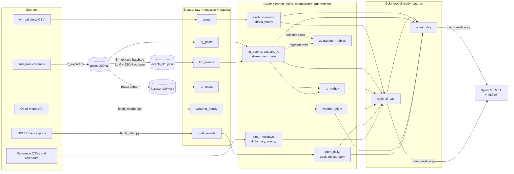

<p align="center">
  
</p>

<h1 align="center">Russian Air Attacks on Ukraine and Air-Raid Alerts, 2022–2026</h1>
<p align="center"><b>A Lakehouse Pipeline on Databricks</b></p>
<p align="center"><em>"Big Data Processing Technologies" Course — Ukrainian Catholic University</em></p>

<p align="center">
  
  
  
  
  
  <br/>
</p>

<p align="center">
  <b>Team BIG</b>
</p>

<table align="center">
  <tr>
    <td align="center" width="180">
      <a href="https://github.com/ruzhylopv">
        <br/>
        <b>Pavlo Ruzhylo</b>
      </a><br/>
      <sub>@ruzhylopv</sub>
    </td>
    <td align="center" width="180">
      <a href="https://github.com/dhvgop-i">
        <br/>
        <b>Ivan Maksymchuk</b>
      </a><br/>
      <sub>@dhvgop-i</sub>
    </td>
    <td align="center" width="180">
      <a href="https://github.com/Oleksii-Lasiichuk">
        <br/>
        <b>Oleksii Lasiichuk</b>
      </a><br/>
      <sub>@Oleksii-Lasiichuk</sub>
    </td>
  </tr>
</table>

<p align="center">
  <a href="proposal/Lasiichuk-Ruzhylo-Maksymchuk.pdf"></a>
</p>

---

## Contents

- [Motivation](#motivation)
- [Research questions](#research-questions)
- [Data sources](#data-sources)
- [Architecture](#architecture)
- [Tables](#tables)
- [LLM enrichment of Telegram posts](#llm-enrichment-of-telegram-posts)
- [Modelling](#modelling)
- [Repository layout](#repository-layout)
- [Running the pipeline](#running-the-pipeline)
- [Conventions and design decisions](#conventions-and-design-decisions)
- [Status](#status)
- [Related work](#related-work)

## Motivation

Public work on the air war over Ukraine is mostly descriptive. Projects count launched and intercepted drones per month, or predict alert onset from alert history alone. We found no open dataset that joins **alerts, attack sizes, weather, news, diplomacy and Ukrainian strikes on Russia** at the *date × oblast* level. We also found no open structured dataset of Ukrainian strikes on Russian territory, or of civilian-casualty reports extracted from Telegram.

This project builds that dataset as a medallion lakehouse (bronze → silver → gold) in PySpark. It runs locally on Parquet or on Databricks as Delta tables, and models are trained on top of it.

## Research questions

1. Do **weather conditions** (cloud cover, wind, precipitation), **moon phase and darkness**, **diplomatic events** and **Ukrainian strikes on Russia** come before changes in attack intensity? We test this with event studies against placebo dates.
2. Can we forecast **next-night attack size** (national) and **next-day alert duration per oblast** better than naive baselines (persistence, 7-day mean)?
3. How large are civilian casualties per oblast and incident, once repeated and revised Telegram reports are deduplicated?

## Data sources

| Source | What we take | Ingestion |
|---|---|---|
| [Ukrainian air-raid sirens dataset](https://github.com/Vadimkin/ukrainian-air-raid-sirens-dataset) | Official alert intervals at oblast, raion and hromada level, 2022–2026 | CSV → `bronze.alerts` |
| Telegram public channels: [@kpszsu](https://t.me/s/kpszsu) (Air Force), [@ssternenko](https://t.me/s/ssternenko), [@lachentyt](https://t.me/s/lachentyt) | Air Force nightly summaries, news on attacks, casualties, strikes on Russia, diplomacy, energy | [`scripts/tg_export.py`](scripts/tg_export.py) scrapes the web preview (no login) → JSONL |
| LLM extraction over Telegram posts | Structured events (see [below](#llm-enrichment-of-telegram-posts)) | [`scripts/llm_extract_batch.py`](scripts/llm_extract_batch.py) → `bronze.llm_events` |
| [Open-Meteo historical weather](https://open-meteo.com) (ERA5) | Hourly temperature, humidity, precipitation, snow, cloud cover, wind for 27 oblast centres | [`scripts/fetch_weather.py`](scripts/fetch_weather.py) → `bronze.weather_hourly` |
| [GDELT 1.0 events](https://www.gdeltproject.org) | Daily events where an actor is UKR/RUS or the event is located in Ukraine/Russia | [`scripts/fetch_gdelt.py`](scripts/fetch_gdelt.py) → `bronze.gdelt_events` |
| Curated reference data | Diplomatic calendar ([`data_ref/diplomacy_events.csv`](data_ref/diplomacy_events.csv)), UA/RU holidays, oblast and Russian-region dictionaries | [`src/pipeline/reference.py`](src/pipeline/reference.py), [`calendars.py`](src/pipeline/calendars.py) |
| Astronomy ([`astral`](https://github.com/sffjunkie/astral)) | Moon illumination at local midnight, darkness hours in Kyiv | computed in `silver.dim_night` |

## Architecture



The same code runs in two modes, switched automatically by [`src/pipeline/io.py`](src/pipeline/io.py):

| | Local | Databricks |
|---|---|---|
| Spark | `local[*]`, Spark 4.0 | serverless compute |
| Storage | Parquet under `data/lake/<layer>/<table>` | Unity Catalog Delta tables `workspace.airwar_<layer>.<table>` |
| Raw files | `data/` | `/Volumes/workspace/airwar_bronze/raw` |
| MLflow | off (results printed) | experiment `/Users/<you>/airwar_baseline` |

## Tables

### Bronze

The raw files are kept unchanged, with two extra columns added: `_ingested_at` and `_source_file`.

`alerts` · `tg_posts` · `llm_events` · `af_regex` · `weather_hourly` (Open-Meteo arrays flattened to one row per oblast-hour) · `gdelt_events`

### Silver

| Table | Grain | Notes |
|---|---|---|
| `dim_oblast`, `dim_raion`, `dim_ru_region`, `dim_night` | reference | 27 oblasts with ISO 3166-2 ids (UA05 … UA85), centres, occupation/frontline flags; moon and darkness per night |
| `alerts` | one alert | Parsed to UTC, joined to oblasts, deduplicated, `alert_id` = SHA-256 of the key |
| `alerts_oblast_intervals`, `alerts_raion_intervals` | merged interval | Overlapping or touching alerts merged per oblast / raion |
| `alerts_oblast_hourly` | oblast × UTC hour | `alert_minutes_any` (any part of the oblast under alert) and `alert_minutes_share` (mean across raions; comparable before and after the December 2025 switch to raion-level alerts) |
| `tg_posts`, `tg_events` | post | LLM output validated, dates checked, out-of-range counts nulled, strikes on Russia re-classified against a region dictionary |
| `casualty_posts`, `casualty_incidents`, `casualty_daily` | post / incident / oblast × day | Repeated and revised casualty reports linked into incidents; final toll = max reported |
| `strikes_on_russia` | day × region × target | `confidence = high` when ≥ 2 channels report it |
| `af_nightly` | night | Air Force launched / shot-down totals: regex parser cross-checked against the LLM, with conflict and quality flags |
| `weather_night` | oblast × night | 18:00–06:59 Kyiv-time aggregates |
| `gdelt_events`, `gdelt_daily`, `gdelt_oblast_daily` | event / day / oblast × day | Mention-weighted tone and Goldstein scale for dyads such as RU→UA conflict, US↔RU diplomacy, threats by Russia |
| `holidays`, `diplomacy_calendar`, `diplomacy_daily`, `energy_events` | day | Calendar features and Telegram diplomacy / energy-strike counts |
| `quarantine_alerts`, `quarantine_tg_events` | rejected row | `table`, `rule`, `record_key`, full JSON `payload` |
| `validation_results` | check | Output of [`validation.py`](src/pipeline/validation.py) |

### Gold

| Table | Grain | Contents |
|---|---|---|
| `national_day` | day, 2022-02-24 → today | Launched / shot down, mean alert share, strikes on Russia by target, civilian casualties, energy strikes, diplomacy signals, GDELT tone; lags 1/2/3/7 and rolling means 3/7/28; moon, darkness, holidays, days since/until diplomatic events, days since the last big (≥ 300) attack; targets `y_next_launched`, `y_next_big_attack`, `y_next_alert_hours_share_avg` |
| `oblast_day` | day × oblast (24 oblasts, 2022-03-15 → 2026-09-06) | Alert hours (any / share / night), local casualties, energy posts, attack posts, GDELT conflict, night weather; per-oblast lags; lagged national context (`nat_*`); targets `y_next_alert_hours_share`, `y_next_night_alert_hours_share` |
| `predictions_national`, `predictions_oblast` | test period | Model predictions next to the naive baselines |

Luhansk, Crimea and Sevastopol are left out of `oblast_day`. They are under near-permanent alert, so the alert data says little about them.

## LLM enrichment of Telegram posts

[`scripts/llm_extract_batch.py`](scripts/llm_extract_batch.py) turns Ukrainian-language Telegram posts into structured records:

1. **`prepare`**: deduplicates posts and keeps the war-relevant ones with a Ukrainian keyword filter. It also parses Air Force nightly summaries with a rule-based regex (`kpszsu_daily.csv`), which serves as an independent cross-check.
2. **`submit` / `status` / `collect`**: sends the posts through the Message Batches API with **Claude Haiku 5.5**. Output is constrained to a strict JSON schema, and the system prompt is cached. `probe` sends one test request and `--sample N` submits a pilot batch.

Extracted fields:

| Field | Values |
|---|---|
| `event_type` | `russian_attack_on_ukraine`, `ukrainian_strike_on_russia`, `casualties_update`, `air_defense_summary`, `diplomacy_politics`, `frontline`, `energy_outage`, `other` |
| `event_date` | event date (not the publication date), resolved from phrases such as "вчора" and "у ніч на" |
| `ua_oblasts`, `ru_regions` | where it happened |
| `weapons` | `shahed`, `jet_shahed`, `decoy_drone`, `ballistic_missile`, `cruise_missile`, `kh22_onyx`, `glide_bomb_kab`, … |
| `launched`, `shot_down`, `killed`, `injured`, `children_killed` | numbers stated in the post, otherwise `null` |
| `target_type` | `energy`, `residential`, `oil_refinery_or_depot`, `airfield`, `industry_defense`, … |
| `is_count_update`, `actors`, `diplomacy_signal`, `summary_en` | revision flag, political actors, diplomatic tone, one-sentence English summary |

The silver layer does not take the model's output at face value:
- event dates must fall within 0–7 days before publication;
- counts above physical limits go to quarantine;
- `shot_down > launched` is nulled;
- "strikes on Russia" are re-checked against a dictionary of Russian regions, and posts about occupied Ukrainian territory are re-labelled;
- civilian casualty fields are kept only for Russian attacks with a named oblast.

> The proposal planned to use the open-weight Gemma 4 on Kaggle GPUs. The current implementation uses Claude Haiku 5.5 through the Batch API.

## Modelling

[`scripts/train_baseline.py`](scripts/train_baseline.py) trains Spark ML **gradient-boosted trees** on the gold tables, using a **time split** (default: test from `2025-10-01`):

| Task | Table | Target | Baselines |
|---|---|---|---|
| `national` | `national_day` (nights with `af_quality = 'ok'`) | next night's launched drones + missiles | persistence (today's value), 7-day mean |
| `oblast` | `oblast_day` | next day's alert hours (raion-share measure) | persistence, 7-day mean |

Trees cannot extrapolate a level that keeps growing, so the GBT is trained on the **residual from the 7-day mean**. Reported metrics are MAE for the GBT and both baselines, plus the top-15 feature importances. On Databricks, parameters, metrics and importances are logged to MLflow.

## Repository layout

```
├── databricks.yml              # Databricks asset bundle (target: dev)
├── resources/pipeline.job.yml  # Job: bronze_silver_gold → train_baseline
├── requirements.txt
├── data_ref/
│   └── diplomacy_events.csv    # hand-curated diplomatic / military milestones
├── proposal/                   # project proposal (PDF)
├── scripts/
│   ├── tg_export.py            # Telegram web-preview scraper
│   ├── fetch_weather.py        # Open-Meteo archive download
│   ├── fetch_gdelt.py          # GDELT 1.0 daily export download + UA/RU filter
│   ├── llm_extract_batch.py    # LLM extraction (Batch API) + Air Force regex parser
│   ├── run_pipeline.py         # bronze → silver → gold → validation
│   └── train_baseline.py       # GBT models vs naive baselines, MLflow
├── src/pipeline/
│   ├── io.py                   # Spark session + read/write (Parquet locally, Delta on Databricks)
│   ├── bronze.py               # raw ingestion with metadata
│   ├── silver.py               # cleaning, dedup, quarantine, interval merging, incident linking
│   ├── gold.py                 # national_day and oblast_day feature tables
│   ├── validation.py           # data-quality checks
│   ├── reference.py            # oblasts, Russian regions, GDELT columns and FIPS map
│   └── calendars.py            # UA / RU holidays
└── tests/test_silver.py        # pytest unit tests for silver logic
```

## Running the pipeline

### Prerequisites

- Python 3.10+ and **Java 17 or 21**, needed by Spark 4 (a Temurin 21 install is picked up automatically on macOS)
- An `ANTHROPIC_API_KEY` in `.env`, only for the LLM extraction step
- The [Databricks CLI](https://docs.databricks.com/dev-tools/cli/) with a profile named `OWN`, only for Databricks runs

```bash
python -m venv .venv && source .venv/bin/activate
pip install -r requirements.txt
```

### 1. Collect raw data

```bash
# Telegram (repeat for ssternenko, lachentyt)
python scripts/tg_export.py kpszsu --since 2022-02-24 --out data/telegram/kpszsu.jsonl

# Weather and news
python scripts/fetch_weather.py --start 2022-02-20 --end 2026-11-15
python scripts/fetch_gdelt.py   --start 2022-02-24 --end 2026-11-18 --workers 4

# Alerts: download official_data_en.csv from the sirens dataset into data/raw/alerts/
```

### 2. Extract events with the LLM

```bash
python scripts/llm_extract_batch.py prepare
python scripts/llm_extract_batch.py probe
python scripts/llm_extract_batch.py submit --sample 200   # pilot
python scripts/llm_extract_batch.py submit                # everything else
python scripts/llm_extract_batch.py status
python scripts/llm_extract_batch.py collect               # → data/llm/events_llm.jsonl + cost report
```

Expected raw layout (relative to `data/` locally, or to the `raw` volume on Databricks):

```
raw/alerts/official_data_en.csv
raw/weather/<oblast_id>.json
raw/gdelt/<YYYYMMDD>.csv.gz
telegram/*.jsonl
llm/events_llm.jsonl
llm/kpszsu_daily.csv
```

### 3. Build the lakehouse and train

```bash
python scripts/run_pipeline.py                         # all steps
python scripts/run_pipeline.py --only telegram,gold    # selected steps
python scripts/train_baseline.py --task national,oblast --test-start 2025-10-01
pytest tests/
```

Pipeline steps: `reference`, `alerts`, `telegram`, `af`, `weather`, `gdelt`, `context`, `gold`, `validate`. The last step prints a `PASS` / `FAIL` line for every data-quality check.

### 4. On Databricks

First upload the raw files to `/Volumes/workspace/airwar_bronze/raw`. Then deploy and run the job:

```bash
databricks bundle deploy -t dev
databricks bundle run airwar_pipeline -t dev
# subset of steps:
databricks bundle run airwar_pipeline -t dev --params only=gold,validate
```

The job `airwar_pipeline` runs on serverless compute in two tasks: `bronze_silver_gold`, then `train_baseline`. Set `PIPELINE_CATALOG` to use a catalog other than `workspace`.

## Conventions and design decisions

- **All timestamps are UTC.** Local Kyiv time is used only to define days.
- **`report_day` runs from 18:00 to 18:00 Kyiv time** and is named after the morning it ends in. This matches the Air Force reporting window: "у ніч на 19 листопада" (18:00, 18 Nov → 08:00, 19 Nov) falls in report day 19 Nov.
- **No leakage in gold.** Anything derived from events (alerts, launches, strikes, casualties, news) enters only with a lag of at least 1 day. Weather, moon, weekday and holidays enter for the same day, because they are known or forecast in advance.
- **Quarantine instead of silent drops.** Rejected rows keep the rule that rejected them and the full payload.
- **Two alert measures.** In December 2025 alerts moved from oblast level to raion level. `alert_minutes_share` averages over raions, so it stays comparable across the switch.
- **Regex vs LLM reconciliation.** For Air Force totals, the regex value is used when it agrees with the LLM within 10 %. On conflict, the LLM's reading of the whole post is used, because the regex tends to double-count. 2022 summaries are marked low quality.
- **Validation** checks reconciliation (bronze = silver + quarantine + duplicates), unique keys, non-null keys, value ranges, reference integrity and coverage, across all layers.

## Status

Deadline: **10 December 2026**.

- [x] Bronze layer: alerts, Telegram, LLM events, Air Force regex, weather, GDELT
- [x] LLM extraction pipeline with JSON-schema-constrained output and regex cross-check
- [x] Silver layer: cleaning, deduplication, quarantine, raion-level harmonisation, casualty incident linking
- [x] Gold layer: `national_day` and `oblast_day` feature tables
- [x] Baseline GBT models vs naive forecasts, MLflow tracking
- [x] Databricks asset bundle and job
- [ ] Extraction accuracy on ~200 hand-labelled posts
- [ ] Event studies with placebo dates; count regression models
- [ ] Anomaly detection on daily attack series
- [ ] AI/BI dashboard, Genie space, presentation

## Related work

1. Pavlyshenko & Pavlyshenko, [arXiv:2411.14625](https://arxiv.org/abs/2411.14625) (2024): random forests predicting alert onset per oblast 5–15 minutes ahead from alert history. They do not use attack size, weather or news.
2. CSIS Futures Lab, [*Russia's massed strikes strategy*](https://www.csis.org/analysis/russias-massed-strikes-strategy-coercion-salvo) (2025): descriptive tracking of salvos, with an average of 8.2 days between major salvos in 2025.
3. Hukovych et al., [*Predicting Missile and Drone Destruction*](https://hukovychb.github.io/media/docs/Predicting-Missile-and-Drone-Destruction.pdf) (2025): weather at one Kyiv station vs interception rates, at national level only.
4. [Institute for Science and International Security](https://isis-online.org) and the [Kyiv Dialogue Ukraine Air War Monitor](https://kyiv-dialogue.org): monthly counts of launched and intercepted drones.
5. P. Ivaniuk, [*Massive Missile Attacks on Ukraine*](https://www.kaggle.com/datasets/piterfm/massive-missile-attacks-on-ukraine) (Kaggle): a manually curated attack table based on Air Force reports.
